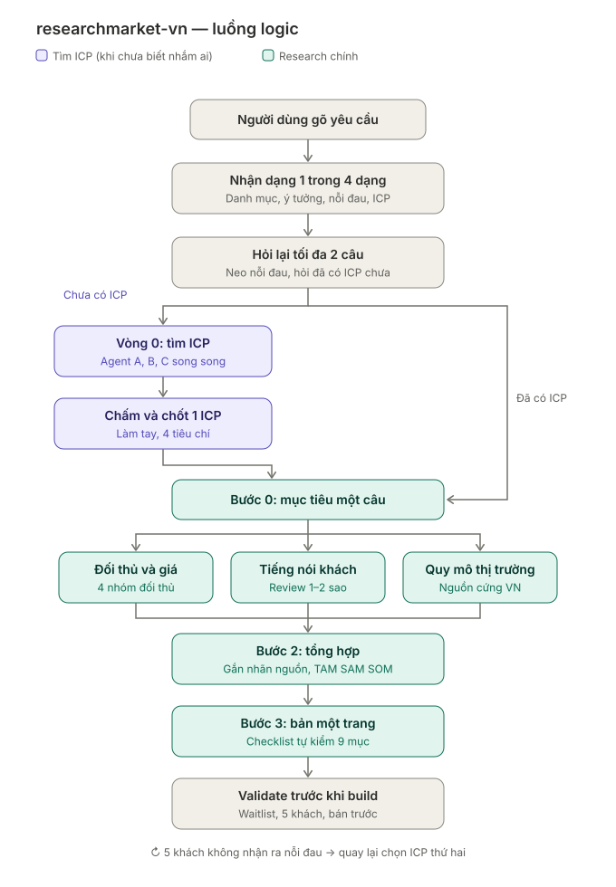

# researchmarket-vn

Skill cho Claude: research thị trường Việt Nam trước khi build sản phẩm để bán.

## Làm gì

Chạy 3 agent song song trên nguồn Việt (Facebook group, Threads, TikTok, Shopee, Zalo, CH Play, group ngành) để trả lời bốn câu hỏi: ngách này có những ai, ai đang trả tiền, giá bao nhiêu, còn khoảng trống nào.

- **Vòng 0 (khi chưa biết nhắm ai):** tìm ai đang than, ai đang trả tiền, ai bị bỏ rơi, rồi chốt 1 ICP.
- **Vòng chính:** đối thủ và giá, tiếng nói khách hàng, quy mô thị trường và dòng tiền.

## Giá trị

- Mọi con số gắn nhãn nguồn: `confirmed` / `secondary` / `vendor-claimed`.
- TAM SAM SOM tính bottom-up từ số liệu VN, không lấy số toàn cầu chia dân số.
- Có mục "số bị từ chối in" cho những con số lan truyền mà không truy được nguồn.
- Neo vào nỗi đau của khách, không neo vào danh mục sản phẩm.
- Hỏi lại tối đa 2 câu rồi chạy, không bắt người dùng điền form dài.

## Đầu ra

Một bản research một trang, gồm:

- Bảng đối thủ 4 nhóm: trực tiếp, gián tiếp, thay thế thủ công, không phải đối thủ (kèm phương án "khách không làm gì cả")
- Bảng giá từng đối thủ, quy về cùng đơn vị
- Bảng nỗi đau, trích nguyên văn tiếng Việt kèm link và ngày
- TAM SAM SOM, có in giả định
- Danh sách những gì không quét được nếu không có tool trả phí
- Gợi ý 3 cách validate trước khi build: waitlist, nói chuyện với 5 khách, bán trước

## Cách dùng

1. Chép thư mục này vào thư mục skills của Claude (hoặc thêm qua phần Skills trong Claude).
2. Gõ `/researchmarket-vn` kèm một trong bốn kiểu:
   - Danh mục: `research thị trường quản lý fanpage VN`
   - Ý tưởng: `tôi muốn làm tool viết content AI`
   - Nỗi đau: `chủ shop than trả lời tin nhắn không xuể`
   - Đã có ICP: `research cho chủ shop Shopee 5–20 nhân viên`
3. Trả lời tối đa 2 câu xác nhận (nỗi đau, đã có ICP chưa).
4. Đọc bản cuối và sửa ít nhất một chỗ agent nói sai.

Muốn quét sâu Facebook, TikTok, Shopee, Google Maps thay vì chỉ search thường: dùng [Apify](https://apify.com/?fpr=get-api), có gói miễn phí để thử.

Chi tiết toàn bộ quy trình nằm trong [SKILL.md](SKILL.md).

Tác giả: [@pennydinh](https://github.com/pennydinh) · [@mp1391004](https://github.com/mp1391004)
